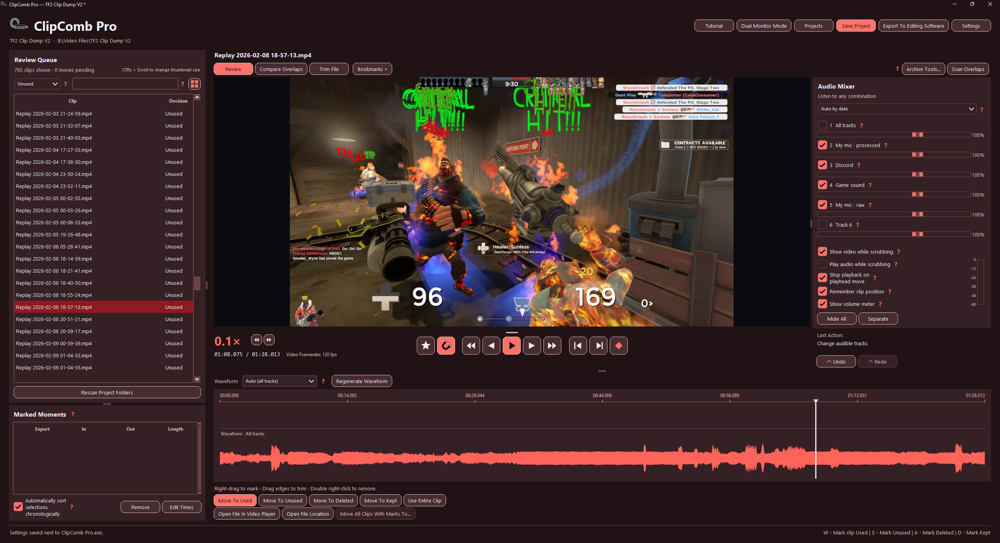
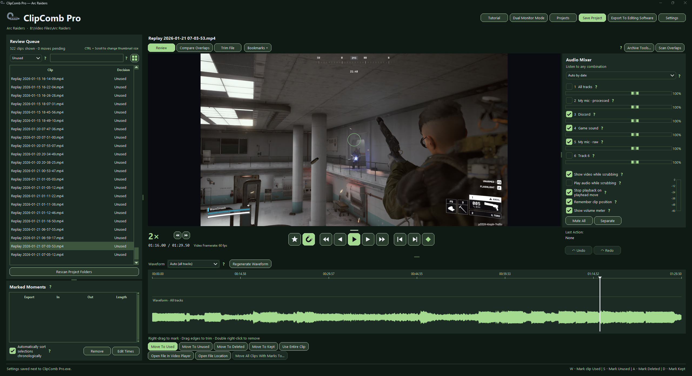
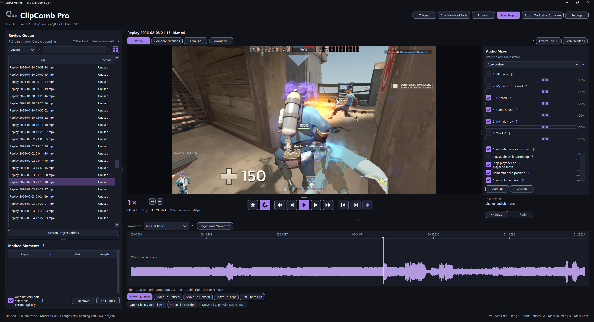
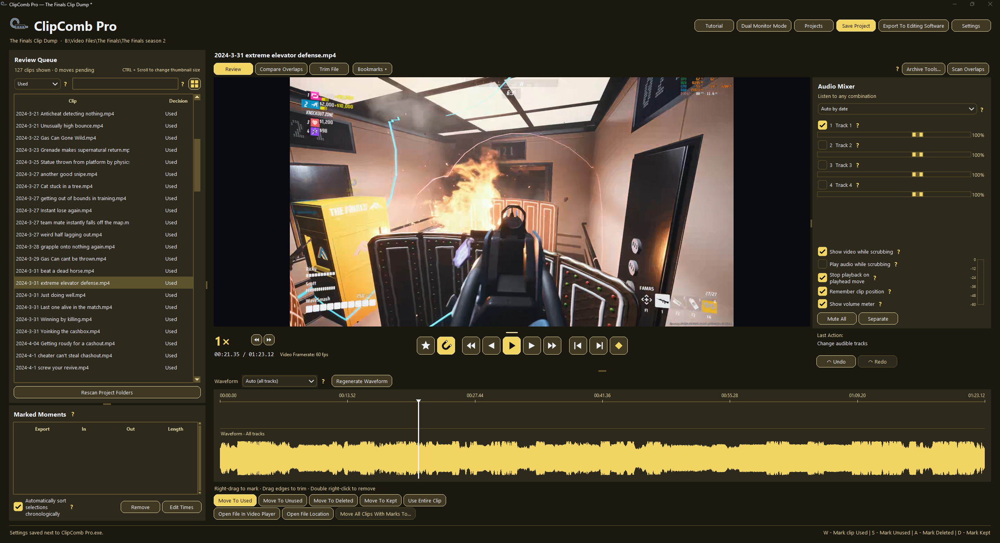
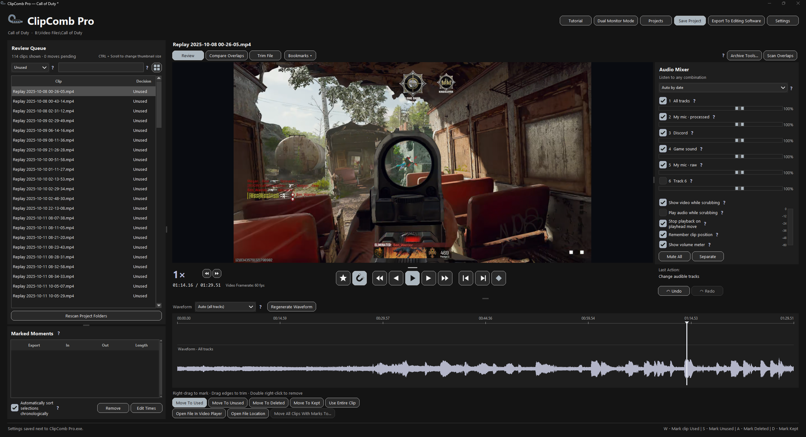

# ClipComb Pro

**Review your gaming clips, keep the good moments, and send your selections to an editor.**

ClipComb Pro is a portable Windows app for working through a large collection of OBS or replay-buffer recordings. It grew out of a personal editing workflow: reviewing clips was taking longer than editing the video.

Please be sure to
[Watch the ClipComb Pro tutorial](https://youtu.be/nMiXShHDSD8)
For setup and usage instructions, and the reasons I chose to use AI in this project.

See [the user guide](app/1%20User%20Guide%20%28Read%20Me%21%29.MD) for even more detail.

## What it does

In a few sentences, ClipComb Pro lets you:
- Watch your clips from a queue at adjustable speeds, with pitch-corrected audio and hardware decoding where supported.
- Listen to separate audio tracks together, with individual names, mute controls and levels.
- Sort clips into **Unused**, **Used**, **Kept** and **Deleted** folders. Folder moves happen when you save; the app does not permanently delete recordings.
- Mark multiple moments in one recording, refine their edges, and reorder them for export.
- Scrub through your clips with audio in realtime, with the ability to zoom in on parts of the image.
- Add clip bookmarks with names, descriptions and colors.
- Find overlapping clips and make verified packet-preserving merges with recoverable originals (merge overlapping clips without losing quality).
- Keep working while overlap scans run in the background.
- Trim files at keyframes, saving space without losing quality (the original untrimmed file is moved to the Deleted folder for you to review later).
- Undo and redo review edits.
- Customize the colors and keybinds, including F1–F24 and mouse buttons.
- Detach the player for a second monitor for fullscreen playback (press Escape to enable fullscreen).
- Preview dark or light themes live, and share your own theme files from the Themes folder.
- Export timelines for DaVinci Resolve, Premiere Pro, Final Cut Pro and Kdenlive with links to the original media.
- **Import portions of clips directly into DaVinci Resolve Studio, including bookmarks.**

## Status and requirements

**ClipComb Pro supports 64-bit Windows 10 and 11.** Playback uses libmpv; metadata and waveform/audio export use FFprobe and FFmpeg.

MP4, MKV, MOV, TS, AV1, HEVC, H.264 and many other formats are supported. GPU support depends on the codec profile, hardware and drivers; software decoding is the fallback. Seeking backward through long-GOP video can be slower because preceding frames must be decoded. Frame inspection prioritizes showing each frame.

On first launch, click **Download Tools** to set up playback. This one-time download needs an internet connection.

## Getting started

1. Extract the app into a folder where it can save its settings. Keep `bridge`, `licenses` and the other included files with it.
2. Open `ClipComb Pro.exe` and click **Download Tools** if prompted.
3. Create a project and choose your video folder. Recordings go in its `Unused` subfolder. Existing `Used`, `Kept` and `Deleted` folders are recognized too.
4. Review clips, mark moments on the timeline, and choose a sorting decision. Press **Ctrl+S** to save the decisions and move the clips into their chosen folders.
5. Press **Ctrl+Shift+E** to export marked moments to a file or import directly to DaVinci Resolve Studio.

## Screenshots

  
  

  
  

## Run or build from source

See [BUILDING.md](app/BUILDING.md). The main entry point is `clip_review.py`. Settings live in `ClipComb Pro.ini`.

## Contributing

Bug reports and focused improvements are welcome! See [CONTRIBUTING.md](app/CONTRIBUTING.md).

ClipComb Pro was developed with assistance from OpenAI Codex.

## License

The app's source and original logo artwork are **GPL-3.0-or-later**; see [LICENSE](app/LICENSE) and [COPYRIGHT.md](app/COPYRIGHT.md). ClipComb Pro is free to download and use. Dependency notices and distribution details are in [THIRD-PARTY.md](app/THIRD-PARTY.md).